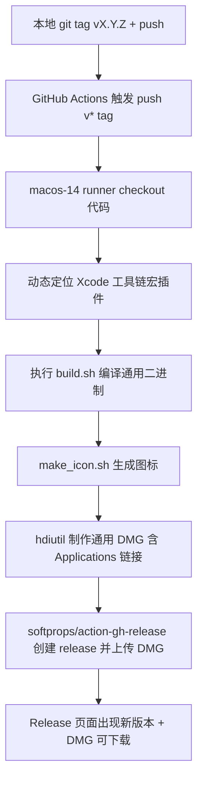

## 产品概述

为 pmap 项目新增 GitHub Actions 自动发版流水线。开发者在本地执行 `git tag vX.Y.Z && git push --tags` 后，GitHub 的 macOS 云主机会自动完成「编译通用二进制 → 打包 app → 生成图标 → 制作 DMG → 创建 release 并上传」，彻底替代当前手动 `hdiutil` + `gh release create` 的流程。

## 核心功能

- tag 触发：push 以 `v` 开头的 tag（如 `v0.1.3`）时自动触发构建。
- 自动构建：在 macOS runner 上执行现有 `build.sh`，产出 x86_64 + arm64 通用二进制。
- 自动打包：调用 `make_icon.sh` 生成图标，用 `hdiutil` 制作带 `/Applications` 符号链接的通用 DMG。
- 自动发布：CI 自动创建 GitHub Release 并上传 DMG，开发者无需手动操作。
- 额度最省：只产出单个通用 DMG，不拆分架构，构建时间最短。

## 约束与边界

- 版本号仍以 build.sh 中的 `VERSION` 变量为单一来源，流程不变。
- 本地 `./build.sh` 手动构建能力完全保留，CI 仅做增量，不影响本地开发。
- 仅改动 build.sh 的宏插件路径定位方式（向后兼容）并新增 workflow 文件，不改动源码逻辑。

## 技术栈

- CI/CD：GitHub Actions
- 运行环境：`macos-14` runner（自带完整 Xcode 工具链、sips、iconutil、hdiutil）
- 发布方式：`softprops/action-gh-release@v2`（社区标准，自动创建 release 并上传产物）
- 脚本：复用现有 `build.sh` 与 `make_icon.sh`

## 实现方案

### 关键决策

1. **宏插件路径动态化（核心难点）**：现有 `build.sh` 第 17 行把 `libSwiftUIMacros.dylib` 路径硬编码为本地 `/Applications/Xcode.app/...`。GitHub runner 的 Xcode 版本路径可能不同。解法：给该路径增加环境变量覆盖（`SWIFTUI_MACROS_PLUGIN`），本地未设置时回退到原硬编码路径（完全向后兼容）；CI 里通过 `xcrun --find swift-frontend` 反推 Xcode 工具链目录，动态定位宏插件。即使定位失败，`build.sh` 现有的 `if [ -f ]` 容错逻辑也会自动跳过插件加载（产物可用，仅多 warning），因此具备双重保险。

2. **release 创建方式**：选用 `softprops/action-gh-release@v2`，相比手写 `gh release create` 更简洁、幂等、无需额外配置 token（直接使用工作流的 `GITHUB_TOKEN`），自动支持同名 release 覆盖/幂等。

3. **权限最小化**：workflow 中声明 `permissions: contents: write`，仅授予创建 release 与上传资产所需的最小权限。

### 架构流程



## 实现细节

### 1. 修改 build.sh（向后兼容的宏插件动态化）

- 在 `XCODE_PLUGIN` 赋值处，优先读取环境变量 `SWIFTUI_MACROS_PLUGIN`，未设置时回退到现有硬编码路径：

```
XCODE_PLUGIN="${SWIFTUI_MACROS_PLUGIN:-/Applications/Xcode.app/Contents/Developer/Platforms/MacOSX.platform/Developer/usr/lib/swift/host/plugins/libSwiftUIMacros.dylib}"
```

- 其余逻辑（`if [ -f ]` 判断、`MACRO_ARGS` 组装）保持不变，确保本地构建行为零变化。

### 2. 新增 workflow 文件

路径：`.github/workflows/release.yml`

关键内容：

- `on.push.tags: ['v*']` 触发。
- `permissions.contents: write`。
- 单 job：`runs-on: macos-14`。
- 步骤：

1. `actions/checkout@v4` 拉取代码（含 tag）。
2. 动态定位宏插件：用 `xcrun --find swift-frontend` 推导 Xcode 目录，导出 `SWIFTUI_MACROS_PLUGIN` 环境变量。
3. `./build.sh` 编译打包。
4. `hdiutil create` 制作 DMG（含 `/Applications` 符号链接）。
5. `softprops/action-gh-release@v2` 上传 DMG，`files` 指向生成的 `*.dmg`，开启 `generate_release_notes: true`。

### 3. 性能与额度

- 单次构建约 1-3 分钟（Swift 编译 + DMG），远低于免费 2000 分钟/月额度。
- 仅 `v*` tag 触发，普通 commit/push 不消耗 CI 资源。
- 只产出单个通用 DMG，避免重复编译两个架构产物导致的额外耗时。

## 目录结构

```
/Users/jiyeqian/Workspace/pmap/
├── .github/
│   └── workflows/
│       └── release.yml    # [新增] 自动发版流水线
└── build.sh               # [修改] 宏插件路径支持环境变量覆盖
```

# Agent Extensions

本次任务无需使用额外 Agent 扩展，直接基于现有 build.sh 与 make_icon.sh 实现。